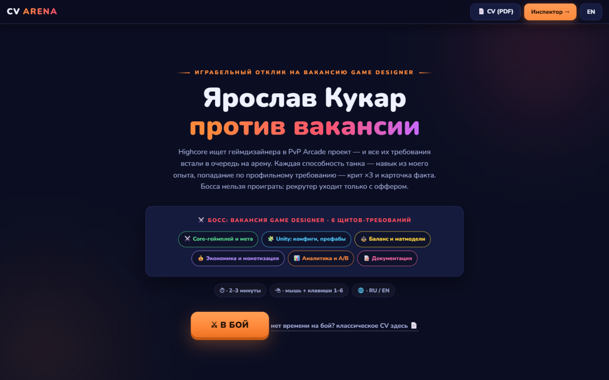
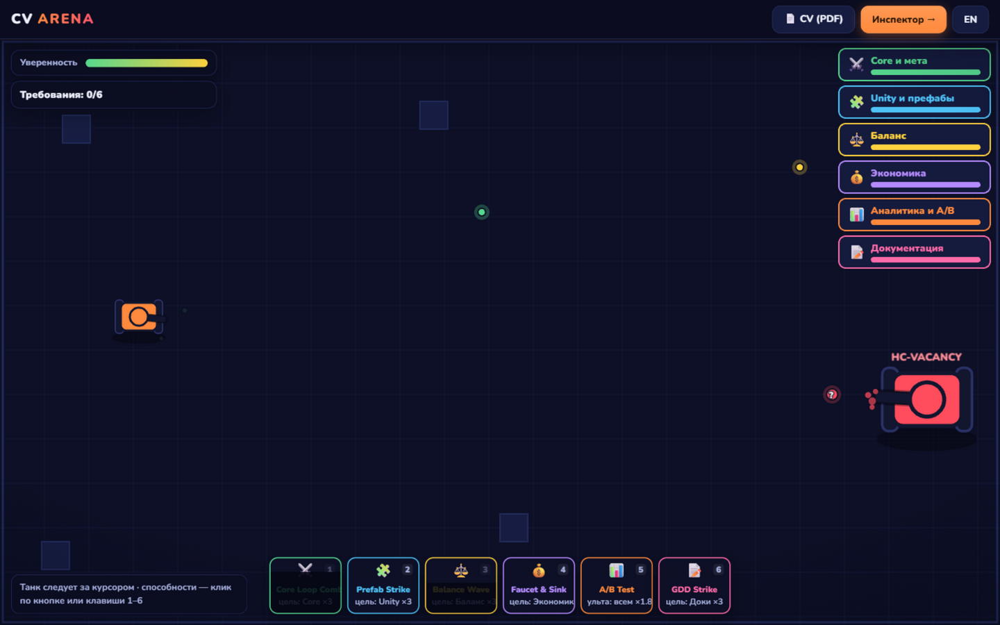
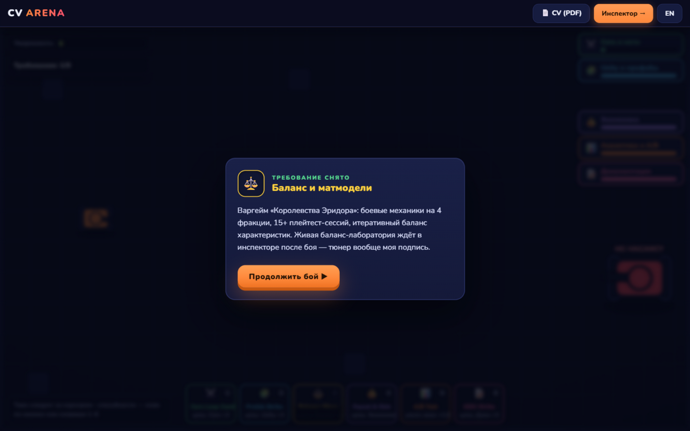
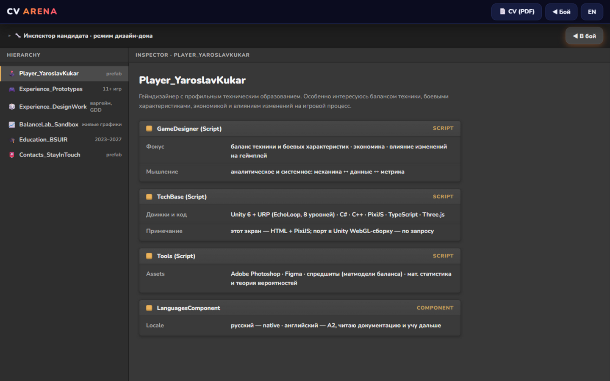
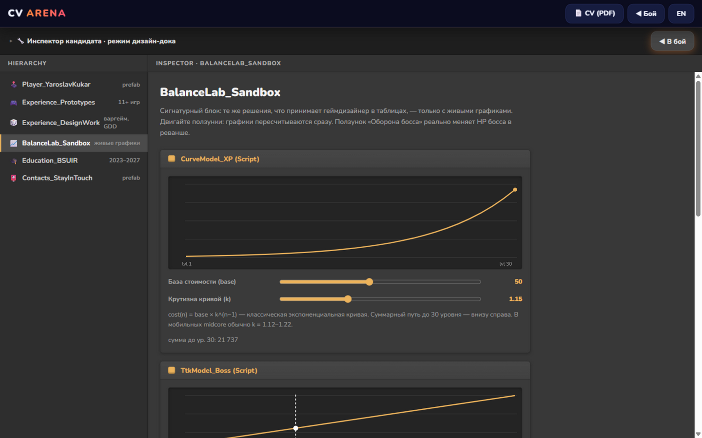

# CV ARENA — резюме против вакансии

Играбельный отклик на вакансию геймдизайнера в [Highcore Games](https://highcore.io/career/detail/game-designer): танк против босса `HC-VACANCY`, у которого каждый щит — требование из вакансии, а каждая моя способность — навык из опыта. После победы открывается инспектор в стиле Unity Editor с баланс-лабораторией. Это седьмая работа в моей серии игровых резюме.

**Играть:** [kerarty.github.io/cv-highcore](https://kerarty.github.io/cv-highcore/)

## Как это устроено

Вакансия требует core-геймплей, баланс, Unity и аналитику — поэтому отклик двухслойный.

**Слой 1 — бой.** Шесть способностей бьют по шести щитам-требованиям босса. Попадание
профильной способностью («Balance Wave» — по щиту «Баланс и матмодели») — крит ×3 и
карточка факта о моём опыте; промах по синергии — обычный урон по случайному щиту.
Каждый сломанный щит открывает факт: серия из 11+ играбельных резюме, Unity 6 + URP
проект EchoLoop, варгейм с 15+ плейтестами, лайвопс-экономики, SDK для playable-рекламы,
GDD. Рекрутера проиграть нельзя: уверенность на нуле — кофе-брейк, классическое CV —
в один клик.

**Слой 2 — инспектор.** Экран в стилистике Unity Editor: Hierarchy с секциями кандидата,
компоненты с полями. Сигнатурный блок — баланс-лаборатория: XP-кривая, TTK-подгонка босса
и экономика faucet/sink пересчитываются на живых графиках, а ползунок «Оборона босса»
реально меняет HP босса в реванше. Рядом — A/B-симулятор: классический PDF-отклик против
играбельного, кривые ретеншена рекрутеров за 7 дней.

Принципы, которые я заложил в отклик:

- **Рекрутера нельзя проиграть** — как и в прошлых откликах: пропуск ведёт сразу
  в инспектор, CV доступно с любого экрана.
- **Тюнер — моя подпись.** Графики не для красоты: ползунки принимают решения,
  одно из них применяется к боссу.
- **Сеттинг — их язык.** PvP-арена в духе Tanks A Lot, требования — щиты босса,
  ульта — A/B тест, потому что проверять гипотезы — часть работы.

## Стек

Чистый веб без сборки: HTML + CSS + ES-модули, [PixiJS 8](https://pixijs.com/) (в репозитории,
без CDN). Весь арт — вектор, нарисованный кодом через Graphics. Локализация RU/EN
переключателем: контент — в `js/data.js`, тексты — в `js/loc.js`. Дизайн-токены, 8pt-сетка,
WCAG-контраст, `focus-visible`, `prefers-reduced-motion`.

## Запуск

Локально: `python serve.py` (сервер с отключённым кэшем) → http://localhost:8391.
Деплой — GitHub Pages из корня `main`.

Дизайн-документ: [PLAN.md](PLAN.md). Классическое резюме: [docs/CV_Yaroslav.pdf](docs/CV_Yaroslav.pdf).

## Контакт

Ярослав Кукар · +375 44 783 84 89 · kukar.yar@gmail.com · [github.com/Kerarty](https://github.com/Kerarty)
